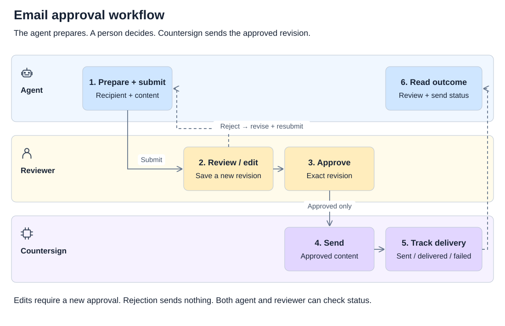
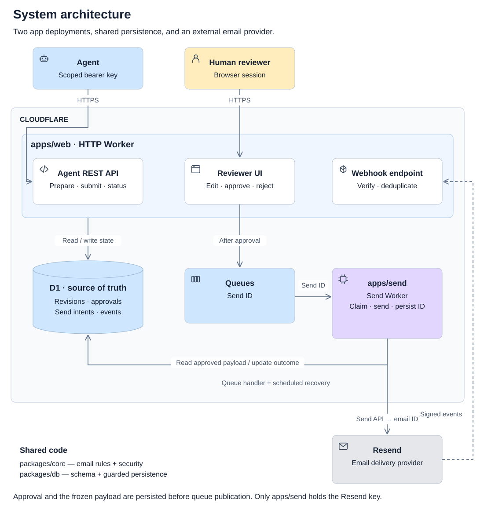

# Countersign

Agents prepare emails, humans review them, and Resend sends the approved revision. Approval covers the exact recipients and content.

[Live app](https://countersign.cristianmartinez.co) · [Agent docs](https://countersign-docs.cristianmartinez.co)

## Try it

Reviewer credentials are shared privately. A private seven-day access link can also sign you in; keep it separate from the agent setup prompt.

1. Sign in, open **Connect your agent** and copy the setup prompt into your agent.
2. Ask: “Prepare a short onboarding follow-up email to `delivered@resend.dev`, submit it for approval and return the review link.”
3. Review the recipient and content. Reject with feedback, or use **Edit email** to save your own revision.
4. Approve it and follow **Sending status** and **Delivery events**. These refresh every five seconds while the page is visible and you are not editing.

Edits need approval before sending. **Sent** means Resend accepted the request; **delivered** means the receiving mail server accepted it. `delivered@resend.dev` is a Resend test address.

## Email lifecycle



## Agent API

The setup prompt includes a scoped bearer key. Agents can create, retrieve, revise and submit emails, then check review and sending status. They cannot approve or send directly.

| Endpoint         | Purpose                                               |
| ---------------- | ----------------------------------------------------- |
| `/SKILL.md`      | Workflow, authentication and retry guidance           |
| `/openapi.json`  | API schemas and examples                              |
| `/onboarding.md` | First email walkthrough                               |
| `/v1/me`         | Authenticated identity, sender and allowed recipients |

Use curl or an identified user agent such as `CountersignAgent/1.0`; the deployed zone rejects Python urllib's default user agent. No MCP installation is required.

## Architecture

TypeScript, Hono, Drizzle and Cloudflare Workers, D1 and Queues. The review UI uses React, shadcn/ReUI and React Email Editor.



Each edit creates an immutable revision. Approval checks its ID and a canonical hash of the sender, recipient, subject, HTML and text. Stale reviews fail, and approved revisions are locked.

`draft → in_review → approved → sending → sent → delivered`

Rejected emails can be revised and resubmitted. Bounce and failure outcomes remain visible. The HTML preview is sandboxed; the editor saves a new revision, and the sender never rerenders approved content.

## Resend and retries

- Only the sender Worker holds the domain-restricted, sending-only Resend key.
- Approval freezes the request and creates one send intent per revision. The official Resend SDK sends that stored payload with a stable idempotency key across retries.
- Database constraints prevent duplicate intents, leases coordinate workers, and Cron recovers missed queue work. D1 is the source of truth.
- Retries use bounded backoff within a 23-hour window. Unresolved outcomes stop for reconciliation before risking a send beyond the provider's idempotency window.
- Signed webhooks are deduplicated and correlated with send intents. Late events cannot overwrite stronger delivery evidence; complaints and delays are recorded separately.

## Run locally

Requires Node 22.22+ and pnpm 9.

```sh
pnpm install --frozen-lockfile
cp apps/web/.dev.vars.example .dev.vars
cp apps/send/.dev.vars.example apps/send/.dev.vars
```

Set `AGENT_KEY_ENCRYPTION_KEY` in `.dev.vars` to a private random 32-byte hex value. Leave `SEND_ENABLED=false` for development. For live testing, set `RESEND_WEBHOOK_SECRET` in the root `.dev.vars` and `RESEND_API_KEY` in the sender's `.dev.vars`.

```sh
pnpm types
pnpm db:migrate
pnpm accounts create < /path/to/private-account.json
pnpm dev
```

The provisioning JSON requires `email`, `name`, `password`, `recipient` and `agentName`. Use a strong password and `delivered@resend.dev` for the test recipient. Sign in to reveal the linked agent's setup prompt. Keep provisioning files and credentials out of Git.

App: `http://localhost:8787`. Docs: `http://localhost:4321`.

For local access links, run `pnpm accounts link < /path/to/private-link-input.json` with `reviewer_id`, `origin` and an `output` path inside `.wrangler/`. The command saves a private file containing the link, expiry and token hash. `pnpm accounts revoke-link` accepts `reviewer_id` and `token_hash` on stdin and revokes the link's sessions too. Password resets also revoke access links.

### Deploy your own instance

Configure your Cloudflare account, D1 database ID, queues, domains and sender in the Wrangler configs. Apply migrations and register `/webhooks/resend` in Resend.

| Worker | Secrets                                             |
| ------ | --------------------------------------------------- |
| Web    | `AGENT_KEY_ENCRYPTION_KEY`, `RESEND_WEBHOOK_SECRET` |
| Sender | `RESEND_API_KEY`                                    |
| Docs   | None                                                |

Use the same sender in web and sender configs. Set `DOCS_URL`, `COUNTERSIGN_APP_URL` and `COUNTERSIGN_DOCS_URL` to your origins. Enable dispatch after domain verification, recipient policy and webhooks are configured.

## Tests

```sh
pnpm check          # formatting, contracts, types, tests and builds
pnpm test:browser   # review, editing, preview isolation, polling and docs
```

Tests cover ownership, stale revisions, concurrent approvals, duplicate requests, retries, uncertain provider outcomes and webhook handling. Automated provider tests use simulated responses. Separate live tests verified the rejection/revision flow, approval and Resend delivery using an agent given only the setup prompt and public docs.

## Scope

One reviewer and linked agent per account, one recipient per email, a fixed sender and preconfigured credentials. Campaigns, segments, attachments, scheduling, inbound mail and account management are outside scope. Five-second polling keeps status updates simple and pauses while hidden or editing.
