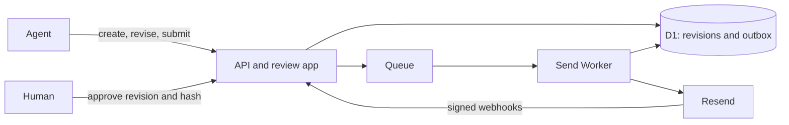

# Countersign

Agents prepare emails. Humans approve the exact recipients and content. Resend sends the approved revision and reports the delivery outcome.

[Live app](https://countersign.cristianmartinez.co) · [Agent documentation](https://countersign-docs.cristianmartinez.co)

## Reviewer walkthrough

Reviewer credentials are shared privately. There is no public signup.

1. Sign in and open **Connect your agent**. Reveal the agent key and copy the setup prompt into your own agent.
2. Give it this task: “Prepare a short onboarding follow-up email to `delivered@resend.dev`, submit it for approval and return the review link.”
3. Inspect the recipient, subject, HTML preview and plain text. Reject with feedback to try the agent revision flow, or use **Edit email** and **Save revision** to make your own changes.
4. Approve the current revision. Follow **Sending status** and **Delivery events**; they refresh every five seconds while the page is visible and you are not editing.

Saving an edit does not approve it. Approval locks the revision. **Sent** means Resend accepted the request; **delivered** means the receiving mail server accepted the message. `delivered@resend.dev` is a Resend test recipient, not a human inbox.

## Agent interface

The setup prompt provides a scoped bearer key and links to public documentation. The identity endpoint requires that key:

| Endpoint         | Purpose                                                 |
| ---------------- | ------------------------------------------------------- |
| `/SKILL.md`      | Workflow, authentication, retries and limits            |
| `/openapi.json`  | Request/response schemas and examples                   |
| `/onboarding.md` | First email walkthrough                                 |
| `/v1/me`         | Authenticated identity, sender and permitted recipients |

Agents can create, retrieve, revise, submit and check email status. Agent credentials cannot approve or send. Reviewer sessions cannot authenticate the agent API. Use curl or an identified user agent such as `CountersignAgent/1.0`; the deployed zone rejects Python urllib's default user agent.

REST and OpenAPI are implemented. MCP is a possible future transport, not required to use the app.

## Architecture and approval rules

TypeScript, Hono, Drizzle, Cloudflare Workers, D1 and Queues. The review interface uses React, shadcn/ReUI components and React Email Editor.



Each change creates an immutable revision. Approval checks both the current revision ID and a canonical hash of the sender, recipient, subject, HTML and text. A stale review cannot approve changed content. Guarded database writes enforce ownership and transitions; a unique send intent binds one approval to one revision.

The normal lifecycle is `draft → in_review → approved → sending → sent → delivered`. Rejection returns feedback to the agent, which can revise and resubmit. Bounce and failure outcomes remain visible. Approved revisions cannot be edited; a later message requires a new draft and approval.

## Resend integration and failure handling

- Only the separate sender Worker holds the domain-restricted, sending-only Resend key. Sending follows persisted approval; there is no public send endpoint.
- Approval freezes the outgoing request. The official Resend SDK sends the stored HTML/text without rerendering. Retries reuse the same payload and provider idempotency key.
- Database constraints prevent duplicate send intents. Queue consumers use leases; Cron recovers work missed between persistence and queue publication.
- Retryable failures use bounded backoff within a 23-hour window. An uncertain outcome stops for reconciliation rather than risking a replacement send beyond the provider's idempotency window.
- Webhooks verify signatures, deduplicate events and correlate provider IDs with send intents. Late events cannot replace delivery evidence with a weaker outcome. Complaint and delay events remain available as details.

The HTML preview is sandboxed and blocks scripts and external resources. Rendering in an inbox can differ. Inline editor saves create a new revision; visual edits can rebuild layout. The approved payload is never modified during sending.

## Run locally

Requires Node 22.22+ and pnpm 9.

```sh
pnpm install --frozen-lockfile
cp apps/web/.dev.vars.example .dev.vars
cp apps/send/.dev.vars.example apps/send/.dev.vars
```

Generate a private random 32-byte hex value for `AGENT_KEY_ENCRYPTION_KEY` in `.dev.vars`. Supply a webhook signing secret for live webhook testing. Leave `SEND_ENABLED=false` for local development; a Resend key is needed only for a deliberate live send. Credentials and `.dev.vars` files must remain untracked.

```sh
pnpm types
pnpm db:migrate
pnpm accounts create < /path/to/private-account.json
pnpm dev
```

The private provisioning JSON contains `email`, `name`, `password`, `recipient` and `agentName`. Choose a strong password and use `delivered@resend.dev` as the recipient for a safe test. The command provisions a local reviewer and linked agent; sign in to reveal the agent setup prompt. Do not put real account values in source or command arguments.

App: `http://localhost:8787`. Docs: `http://localhost:4321`.

### Deployment

The Wrangler configs describe separate web, sender and static-docs Workers. Before deploying your own instance, configure your Cloudflare account, D1 database ID, queue names, custom domains and sender. Production identifiers are deliberately omitted from this repository. Apply D1 migrations, configure secrets privately, and register `/webhooks/resend` in Resend.

| Worker | Secrets                                             |
| ------ | --------------------------------------------------- |
| Web    | `AGENT_KEY_ENCRYPTION_KEY`, `RESEND_WEBHOOK_SECRET` |
| Sender | `RESEND_API_KEY`                                    |
| Docs   | None                                                |

Set the same sender in web and sender configs. Enable dispatch only after domain verification, recipient policy and the webhook endpoint are configured. Set `DOCS_URL` and the docs build's `COUNTERSIGN_APP_URL` / `COUNTERSIGN_DOCS_URL` to your public origins. Never commit provisioning files or secret values.

## Verification

```sh
pnpm check          # formatting, generated contracts, types, tests and builds
pnpm test:browser   # reviewer flow, preview isolation, polling and docs
```

Focused tests cover ownership and approval rules, stale revisions, concurrent approvals, mutation replay, duplicate queue deliveries, send retries, ambiguous provider outcomes and signed webhook projection. Automated provider tests use simulated responses.

On 21 October 2026, a fresh agent using only the production setup prompt and public docs completed create, submit, rejection, revision and resubmission. A separate reviewer session approved the revision; the agent observed delivery through live Resend webhooks. A second fresh session submitted without failed requests or API coaching. This verifies the tested sessions, not every agent client's configuration.

## Scope and tradeoffs

One reviewer and linked agent per account, one recipient per email, a fixed sender and preconfigured credentials keep the assessment focused on approval integrity and delivery. Campaigns, segments, attachments, scheduling, inbound mail and account management are outside scope.

Five-second polling keeps the client simple. It pauses while hidden or editing; agents receive polling and stopping guidance. D1 remains the source of truth rather than relying on queue delivery order or in-memory locks.
